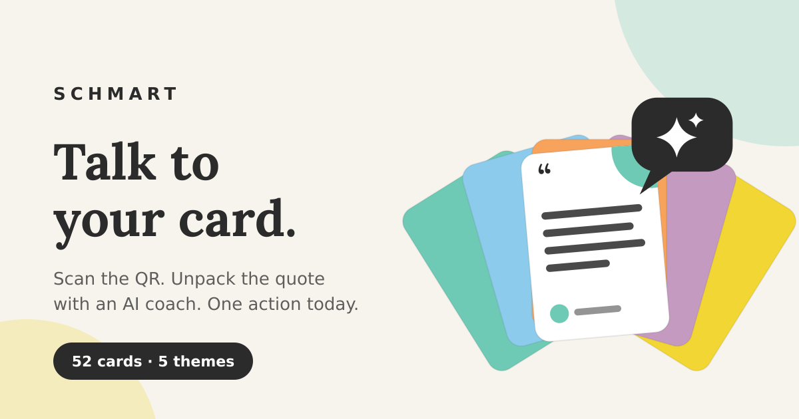

# Schmart Coach — talk to your card



**Live demo:** https://schmartcoach.figma.site/ · try a card: https://schmartcoach.figma.site/?card=steve-jobs&view=card

Junction 2026 · Track: **The Internet Butler / Your Personal Assistant (Exa)**

## The problem
**Schmart Cards 2.0** is a printed deck of 52 motivational cards (quotes from legends, actors, singers, movie characters and daily "Today is day to…" actions) that I use with ~35 students in my sales and leadership organisation in Estonia. A card inspires for 10 seconds and then goes in a drawer. Nobody knows the real story behind the quote, a lot of internet quotes are misattributed, and the idea is rarely turned into action.

## What it does
Every printed card has its own QR code. Scanning it opens a personal AI coach for that exact card:

- **Unpack the quote**: one question, the real story, a link to your day, and **one concrete action for today** (saved with a Done checkbox, history and streaks).
- **Discuss a topic**: 4–6 talking points generated per card.
- **Learn more**: facts and stories about the person, the film, or the research behind a daily action.
- The coach talks **about** the person, never **as** them. No fake celebrity chatbots.

## How Exa does the digging
| Step | Exa endpoint | What happens |
|---|---|---|
| Research (once per card) | `/search` · `type: deep-lite` · `outputSchema` · `excludeDomains` | Finds sources and returns a structured knowledge pack: attribution status, context, 8–12 facts with source URLs, stories, talking points, opener. Quote-collection sites are excluded so attribution is decided on primary sources. |
| Coaching (every message) | `/answer` · `outputSchema {reply, action}` | Reply grounded in the card's knowledge pack plus live web search. |

Results across the deck: **367 facts, all with a source URL**, ~10 sources per card. Attribution: 17 verified · 2 likely · 4 disputed · 12 origin not confirmed · 7 fictional characters · 10 research-based actions. When the origin is not confirmed, the app says so and the coach says "a line often attributed to…".

Cost: ~$0.012 to research one card, ~$0.005 per chat message. Replies in 2–4 s.

## Safety
- Crisis messages (EN/RU/ET) skip the model and immediately show Estonian helplines (116 123, 116 006, 116 111, 112).
- Refuses role-play as the celebrity, gossip/scandals and prompt-injection attempts.
- Per-IP rate limits and a daily budget cap. No login, no personal data; IPs are stored only as a salted hash.
- Junk/half-JSON "actions" from the model are filtered server-side.

## Architecture
```
Printed card ──QR (QRFY, dynamic)──▶ Front-end (Figma Make, React, HashRouter)
                                         │  POST /functions/v1/chat  (no keys in the browser)
                                         ▼
                              Supabase Edge Function `chat` (Deno)
                               ├─ op: cards / card / sources / waitlist
                               ├─ start chat → opener from knowledge pack
                               └─ message → Exa /answer → {reply, action}
                                         │
                              Supabase Postgres (cards, sources, chats, messages, waitlist, RLS)
                                         ▲
                              Edge Function `ingest-card` → Exa /search (deep-lite + outputSchema)
```

## Repository
| Path | Contents |
|---|---|
| `supabase/schema.sql` | Tables, `cards_public` view, RLS policies, migrations |
| `supabase/seed.sql` | The 52 cards with research hints |
| `supabase/functions/ingest-card` | Exa research pipeline → knowledge pack |
| `supabase/functions/chat` | Coach chat, public data API, safety and rate limits |
| `ingest-all.sh` | Re-research every card |
| `cards_registry.csv` | All 52 cards with their QR links |
| `docs/figma-make/` | The prompts used to build the front-end in Figma Make |
| `assets/` | Social preview and icon |

## Run it yourself
1. Create a Supabase project, run `supabase/schema.sql` then `supabase/seed.sql`.
2. Deploy both functions (Verify JWT off). Secret: `EXA_API_KEY` (optional `ADMIN_TOKEN`, `EXA_INGEST_TYPE`, `EXA_CHAT_MODEL`).
3. Research the cards: `POST /functions/v1/ingest-card {"card_id":"steve-jobs"}` or `bash ingest-all.sh`.
4. Point the front-end at `https://<project>.supabase.co/functions/v1/chat` (see `docs/figma-make/FIGMA_MAKE_PROMPT_CONNECT.md`).

## Who it's for
Young people aged 16–25: sales students, schools and teams running Schmart workshops. Next: a pilot with 35 students, anonymous device IDs for analytics, then courses and 1:1 coaching inside the app.

Built by **Nikita Vlassenkov**.
